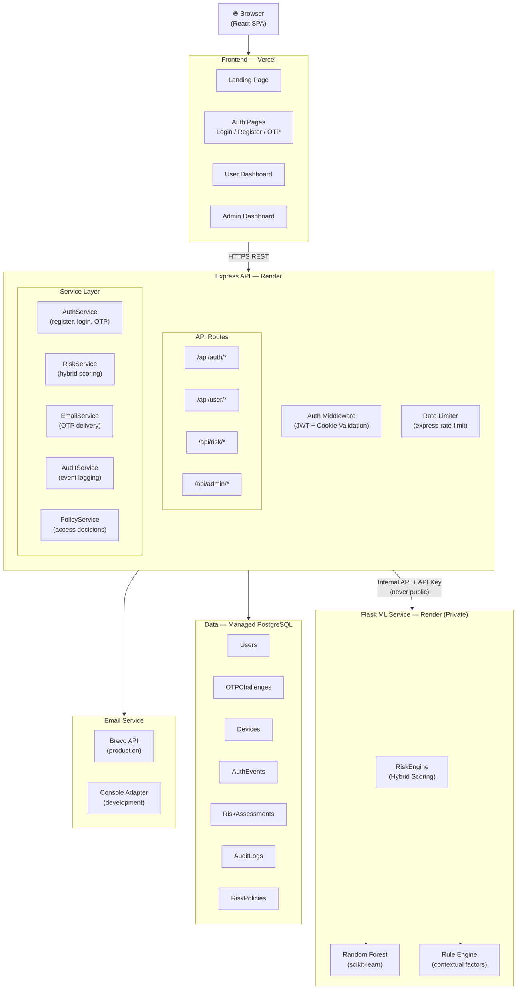
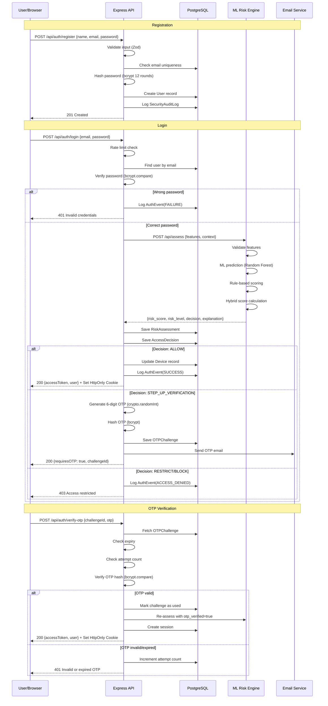
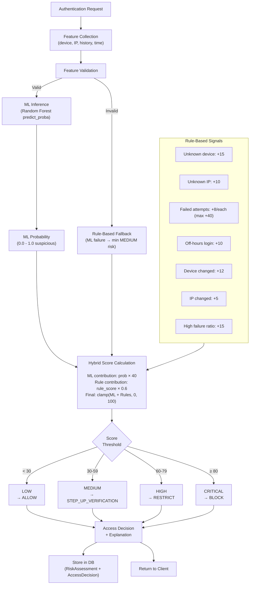
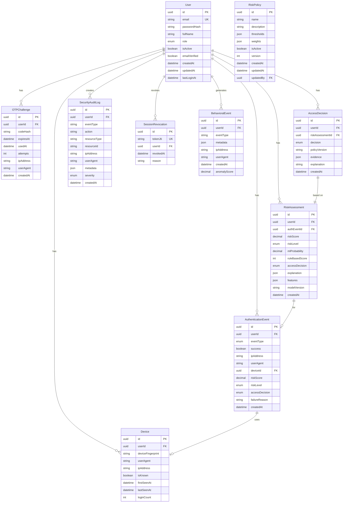

# ZeroTrustX — Architecture Documentation

## Overview

ZeroTrustX implements a three-tier architecture with a separate ML microservice:

1. **Presentation Tier**: React SPA (Single Page Application)
2. **Application Tier**: Express REST API (Node.js/TypeScript)
3. **Intelligence Tier**: Flask ML Risk Engine (Python)
4. **Data Tier**: PostgreSQL (via Prisma ORM)

---

## System Architecture Diagram



---

## Authentication Flow



---

## Risk Assessment Architecture



---

## Database Schema



---

## Security Layers

| Layer | Mechanism | Purpose |
|-------|-----------|---------|
| Transport | TLS (Vercel/Render auto) | Encrypt all traffic |
| Authentication | bcrypt (12 rounds) | Secure password storage |
| Session | JWT + HttpOnly Cookie | Tamper-proof session |
| Session Revocation | JTI blocklist in DB | Invalidate specific sessions |
| API Authorization | JWT middleware | Protect authenticated routes |
| Role Authorization | Admin middleware | Protect admin routes |
| MFA | Email OTP (bcrypt hashed) | Step-up verification |
| Rate Limiting | express-rate-limit | Prevent brute-force |
| Input Validation | Zod schemas | Prevent injection |
| Security Headers | Helmet.js | Prevent XSS, clickjacking |
| CORS | Configured origin whitelist | Prevent CSRF |
| Audit Trail | SecurityAuditLog | Forensic capability |
| ML Service | Internal API key | Prevent public access |

---

## ML Service Architecture

### Feature Engineering

Features extracted at login time from server-side context:

| Feature | Type | Range | Description |
|---------|------|-------|-------------|
| `device_known` | bool | 0/1 | Device fingerprint in user's known devices |
| `ip_known` | bool | 0/1 | IP address seen before for this user |
| `recent_failed_attempts` | int | 0-50 | Failed login attempts in last hour |
| `login_hour` | int | 0-23 | Hour of login in UTC |
| `time_since_last_login` | float | 0-8760 | Hours since last successful login |
| `device_changed` | bool | 0/1 | Device different from last login |
| `ip_changed` | bool | 0/1 | IP different from last login |
| `login_frequency` | float | 0-100 | Average logins per day (30-day window) |
| `is_off_hours` | bool | 0/1 | Login between 23:00-05:00 UTC |
| `failed_to_success_ratio` | float | 0-1 | Recent failure rate |

### Hybrid Scoring Formula

```
ml_contribution = ml_probability × 40          # ML provides up to 40 points
rule_contribution = rule_score × 0.6           # Rules provide up to 60 points
hybrid_score = clamp(ml_contribution + rule_contribution, 0, 100)
```

### Synthetic Data Disclaimer

> ⚠️ **Important**: The Random Forest model is trained on synthetic data generated by `generate_dataset.py`. This data uses statistical distributions designed to distinguish "normal" from "suspicious" logins for demonstration purposes. The model's performance metrics (accuracy, F1, ROC-AUC) are measured on a held-out portion of the same synthetic dataset and do not represent real-world attack-detection capability. A production deployment should be retrained on real labeled authentication data.

---

## Behavioral Anomaly Detection (Extension)

The Isolation Forest–based behavioral anomaly detection module is designed for Phase 7 and may be incomplete in the current version.

**Planned features:**
- Per-user Isolation Forest trained on behavioral event sequences
- 30-minute correlation window for suspicious activity clustering
- Anomaly score contribution to hybrid risk scoring
- Configurable sensitivity threshold

**Current status**: See `services/risk-engine/behavioral_engine.py` if present, or documented as a future enhancement.

---

## Deployment Architecture

```
┌─────────────────────────────────────────────────────────────────┐
│                         Vercel Edge Network                       │
│                    React SPA (apps/web)                          │
│              VITE_API_URL → Render Express service               │
└───────────────────────────┬─────────────────────────────────────┘
                            │ HTTPS
                            ▼
┌─────────────────────────────────────────────────────────────────┐
│                    Render Web Service                             │
│                  Express API (apps/api)                           │
│          DATABASE_URL → Managed PostgreSQL                        │
│          ML_SERVICE_URL → Render Python service                   │
│          (ML service URL not exposed to browser)                  │
└──────────────┬────────────────────────────┬───────────────────────┘
               │ Internal                    │
               ▼                            ▼
┌──────────────────────┐     ┌──────────────────────────────────┐
│  Render Web Service  │     │     Managed PostgreSQL            │
│  Flask ML Engine     │     │     (Render / Neon / Supabase)   │
│  (private endpoint)  │     └──────────────────────────────────┘
└──────────────────────┘
```

---

*Last updated: 2026-10-29*
