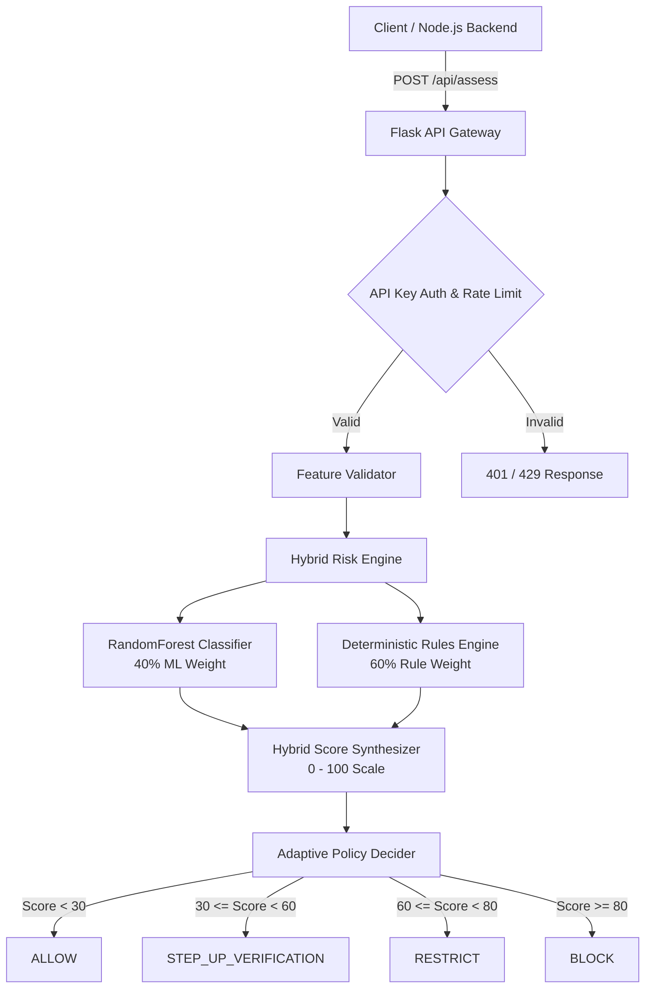

# ZeroTrustX - AI-Powered Adaptive Risk Engine

The **ZeroTrustX Risk Engine** is a high-performance Python microservice that provides intelligent, real-time risk assessment and adaptive access control decisions for authentication attempts. Following the core zero-trust philosophy — **"Never Trust, Always Verify"** — it dynamically evaluates every authentication request using a hybrid approach combining machine learning anomaly detection with deterministic contextual security policies.

---

## Architecture Overview



### Hybrid Risk Calculation
The platform computes a unified hybrid risk score between `0.0` and `100.0`:
$$\text{Risk Score} = \min\left(100.0, (\text{ML Probability} \times 40.0) + (\text{Rule Score} \times 0.6)\right)$$

- **ML Random Forest Model (40% Weight):** Evaluates multidimensional behavioral anomaly probabilities against historical baseline authentication patterns.
- **Rule-Based Engine (60% Weight):** Applies strict contextual security policies (unknown device, unfamiliar IP, off-hours access, rapid failed attempts, and device switching).

---

## Feature Definitions

| Feature Name | Type | Range | Description |
| :--- | :--- | :--- | :--- |
| `device_known` | bool / int | `[0, 1]` | `1` if device fingerprint was previously recognized for user; `0` otherwise |
| `ip_known` | bool / int | `[0, 1]` | `1` if IP address was previously observed for user; `0` otherwise |
| `recent_failed_attempts` | int | `[0, 50]` | Number of failed login attempts in the past 60 minutes |
| `login_hour` | int | `[0, 23]` | UTC hour of login event |
| `time_since_last_login` | float | `[0, 8760]` | Elapsed hours since last successful authentication (up to 1 year) |
| `device_changed` | bool / int | `[0, 1]` | `1` if device changed compared to previous login session; `0` otherwise |
| `ip_changed` | bool / int | `[0, 1]` | `1` if IP changed compared to previous login session; `0` otherwise |
| `login_frequency` | float | `[0, 100]` | Rolling 30-day average login frequency (logins/day) |
| `is_off_hours` | bool / int | `[0, 1]` | `1` if login occurs during off-hours (23:00 - 05:00 UTC); `0` otherwise |
| `failed_to_success_ratio` | float | `[0.0, 1.0]` | Ratio of failed attempts to total attempts in observation window |

---

## Deterministic Rule Scoring

| Condition | Rule Contribution | Policy Rationale |
| :--- | :---: | :--- |
| `device_known == 0` | `+15` | Unrecognized device fingerprint |
| `ip_known == 0` | `+10` | Unrecognized source IP address |
| `recent_failed_attempts > 0` | `+8 per attempt` *(max +40)* | Credential stuffing or brute-force pattern |
| `is_off_hours == 1` | `+10` | Out-of-profile off-hours access attempt |
| `device_changed == 1` | `+12` | Sudden device switch between sessions |
| `ip_changed == 1` | `+5` | Network transit / location switch |
| `failed_to_success_ratio > 0.5` | `+15` | High failure rate across session window |

---

## Risk Tiers & Access Decisions

| Risk Tier | Score Range | Default Decision | Behavior with Verified OTP |
| :--- | :---: | :---: | :--- |
| **LOW** | `0 - 29.9` | `ALLOW` | Direct authenticated access granted |
| **MEDIUM** | `30.0 - 59.9` | `STEP_UP_VERIFICATION` | Lowered to `ALLOW` if score `< 45.0` after OTP verification |
| **HIGH** | `60.0 - 79.9` | `RESTRICT` | Restricted access; requires supervisor / admin intervention |
| **CRITICAL** | `80.0 - 100.0` | `BLOCK` | Session terminated and account locked |

---

## Setup & Installation

### 1. Requirements
- Python 3.10+ (Recommended Python 3.11)
- Virtual environment (recommended)

### 2. Environment Configuration
Copy `.env.example` to `.env`:
```bash
cp .env.example .env
```

Configure parameters:
```env
FLASK_ENV=development
FLASK_HOST=0.0.0.0
FLASK_PORT=5001
FLASK_SECRET_KEY=change_this_secret_key
ML_INTERNAL_API_KEY=change_this_to_match_express_config
MODEL_DIR=./models
```

### 3. Install Dependencies
```bash
pip install -r requirements.txt
```

---

## Dataset Generation & Model Training

### Generate Synthetic Dataset
To generate 10,000 synthetic authentication events (85% normal, 15% suspicious) with realistic distributions:
```bash
python generate_dataset.py
```
Output is saved to `data/synthetic_auth_data.csv`.

### Train Random Forest Model
To train the classifier, evaluate performance metrics, and export model artifacts:
```bash
python train_model.py
```
This produces:
- `models/risk_model.pkl`: Serialized `RandomForestClassifier`
- `models/feature_names.pkl`: Ordered feature schema list
- `models/model_metadata.json`: Model version, training parameters, and evaluation metrics

### Model Performance Metrics (Trained Benchmark)
- **Model Algorithm:** `RandomForestClassifier(n_estimators=100, class_weight='balanced')`
- **Accuracy:** `98.25%`
- **ROC-AUC Score:** `0.9541`
- **Macro F1-Score:** `0.9666`
- **Suspicious Class F1-Score:** `0.9435` (Precision: `97.33%`, Recall: `91.54%`)
- **Data Source:** Synthetic authentication telemetry (10,000 events: 8,405 normal, 1,595 suspicious)

---

## Running the Service

### Start Development Server
```bash
python app.py
```
The service binds to `http://0.0.0.0:5001`.

### Production Deployment (Gunicorn)
```bash
gunicorn -w 4 -b 0.0.0.0:5001 "app:create_app()"
```

---

## API Endpoints

### 1. `GET /health`
Public liveness probe. No authentication required.
```json
{
  "service": "ZeroTrustX Risk Engine",
  "status": "healthy",
  "timestamp": "2026-10-29T14:10:00Z"
}
```

### 2. `GET /api/health`
Detailed authenticated health status with model version and metadata.
**Headers:**
- `X-API-Key: <ML_INTERNAL_API_KEY>`

**Response (200 OK):**
```json
{
  "features_loaded": 10,
  "metadata": { ... },
  "model_version": "1.0.0",
  "service": "ZeroTrustX Risk Engine",
  "status": "healthy",
  "timestamp": "2026-10-29T14:10:00Z"
}
```

### 3. `POST /api/assess`
Evaluates the risk score and policy decision for an incoming login event.
**Headers:**
- `X-API-Key: <ML_INTERNAL_API_KEY>`
- `Content-Type: application/json`

**Request Body:**
```json
{
  "features": {
    "device_known": 1,
    "ip_known": 1,
    "recent_failed_attempts": 0,
    "login_hour": 14,
    "time_since_last_login": 12.5,
    "device_changed": 0,
    "ip_changed": 0,
    "login_frequency": 3.2,
    "is_off_hours": 0,
    "failed_to_success_ratio": 0.0
  },
  "otp_verified": false
}
```

**Response (200 OK):**
```json
{
  "access_decision": "ALLOW",
  "explanation": [
    "Baseline behavioral profile verified. No anomalous rule triggers.",
    "ZeroTrustX ML Anomaly Engine assessed a 2.4% suspicion probability."
  ],
  "feature_validation": {
    "errors": [],
    "valid": true
  },
  "ml_probability": 0.024,
  "model_version": "1.0.0",
  "risk_level": "LOW",
  "risk_score": 0.96,
  "rule_based_score": 0,
  "timestamp": "2026-10-29T14:10:00.123456+00:00"
}
```

---

## Running Automated Tests

Run the complete test suite covering risk engine logic and Flask API endpoints:
```bash
pytest -v tests/
```

Test coverage includes:
- Feature schema and boundary validation
- Out-of-range value rejections
- Missing feature handling and fail-fast triggers
- Clamping of hybrid risk scores `[0, 100]`
- Rule-based accumulation and threshold mapping
- OTP verification downgrades
- Rate limiting and API key authentication enforcement

---

## DISCLAIMER

> **IMPORTANT**: The default training dataset used by this service is synthetically generated to model baseline enterprise login distributions, brute-force anomalies, and credentials abuse patterns. For production deployment in enterprise zero-trust perimeters, models should be continuously retrained with telemetry from your identity provider (IdP), SSO audit logs, and verified organizational security telemetry.
